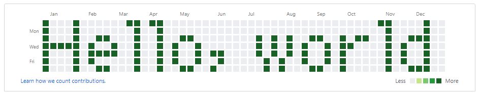

# GIT-TURF(1)

## NAME

`git-turf` — Draw words on your GitHub lawn.

## SYNOPSIS

```txt
git-turf [OPTIONS] MESSAGE
```

## DESCRIPTION

This command draws messages on your GitHub contribution graph.

In Japan, the contribution calendar is nicknamed “grass” or “lawn” because of its green squares, and committing is sometimes described as “growing grass.”

Tame your GitHub garden and paint a message!

## OPTIONS

- `-d DATE`, `--date DATE`
  - Start date. Format is `YYYY-MM-DD`.  Default is 52 weeks ago from today, adjusted to the previous Sunday.

- `-t TIME`, `--time TIME`
  - Commit time. Format is `HH:MM:SS`.  Default is now time.

- `-n`, `--dry-run`
  - Display message only.

- `-h`, `--help`
  - Show help message and exit.

- `-v`, `--version`
  - Show program's version number and exit.

## EXAMPLES

```txt
$ git-turf "Hello, world"
#   #      ## ##                            ##    #
#   #       #  #                             #    #
#   #  ##   #  #  ##        # # #  ##  # ##  #  ###
##### #  #  #  # #  #       # # # #  # ##    # #  #
#   # ####  #  # #  # ##    # # # #  # #     # #  #
#   # #     #  # #  #  #     # #  #  # #     # #  #
#   #  ##   #  #  ##  #      # #   ##  #     #  ###
$ git push
```



## INSTALLATION

### Requirements

- Python 3.5 or higher

### Install

```console
git clone https://github.com/yoshi389111/git-turf.git
cd git-turf
pip3 install -e .
```

or

```console
pip3 install git+https://github.com/yoshi389111/git-turf.git
```

### Uninstall

```console
pip3 uninstall git-turf
```

## FAQ

- Q1: does running this app clear the existing calendar?
  - Running this app will not clear your existing calendar.  It will just add ASCII banner commits to your existing calendar.

- Q2: does the calendar have to be blank?
  - The calendar doesn't have to be blank, but it looks better if it is.

- Q3: what happens if it's run twice with different input?
  - Two ASCII banners are displayed one on top of the other.

- Q4: does it depend on a certain version of GitHub environment?
  - It does not depend on a certain version.

- Q5: what is the recommended way to do this?

  - My recommendation is to create a new empty repository and commit and push to it.  Once you've had enough fun, you can just delete the repository.

## COPYRIGHT

### Program

&copy; 2019 SATO Yoshiyuki.

Licensed under the MIT License.

### Fonts

The bitmap is created based on the `misaki_gothic.bdf` font and the `k6x8.bdf` font.

- `misaki_gothic.bdf`
  - Copyright(C) 2000-2007 Num Kadoma
  - <https://littlelimit.net/misaki.htm>
  - Version: 2019-06-03a

- `k6x8.bdf`
  - Copyright(C) 2002-2019 Num Kadoma
  - <https://littlelimit.net/k6x8.htm>
  - Version: k6x8 period beta2

- License of fonts
  - <https://littlelimit.net/font.htm>
    > These fonts are free software.
    > Unlimited permission is granted to use, copy, and distribute them,
    > with or without modification, either commercially or noncommercially.
    > THESE FONTS ARE PROVIDED "AS IS" WITHOUT WARRANTY.
